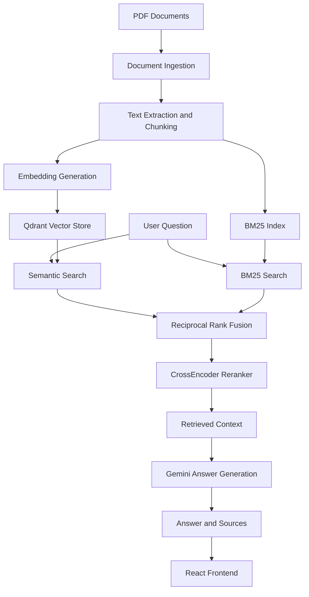

# Production RAG with Hybrid Search

A production-oriented Retrieval-Augmented Generation (RAG) application that combines semantic search, keyword retrieval, Reciprocal Rank Fusion (RRF), and CrossEncoder reranking to answer questions from documents.

The application uses FastAPI for the backend, React for the frontend, Qdrant for vector storage, and Gemini for answer generation.

## Overview

Traditional RAG systems often rely only on semantic similarity. This project combines multiple retrieval methods to improve the discovery of relevant document passages.

The system retrieves candidate chunks using both dense semantic search and BM25 keyword search, fuses their rankings, reranks the candidates, and generates a grounded answer using the retrieved context.

### Key Features

- PDF document ingestion and chunking
- Dense semantic retrieval using vector embeddings
- BM25 keyword-based retrieval
- Reciprocal Rank Fusion for combining retrieval rankings
- CrossEncoder-based reranking
- Gemini-powered answer generation
- Source document and page information in responses
- Retrieval metadata and performance metrics
- FastAPI backend with a React frontend
- PDF upload and indexing endpoint
- Automated tests using pytest
- Retrieval evaluation using Hit@5, MRR@5, and Recall@5

## Architecture



## Technology Stack

| Component | Technology |
|---|---|
| Backend API | FastAPI |
| Frontend | React |
| Frontend development server | Vite |
| Model Hub | Hugging Face Hub |
| Vector database | Qdrant |
| Semantic retrieval | Sentence Transformers |
| Keyword retrieval | BM25 |
| Rank fusion | Reciprocal Rank Fusion |
| Reranking | CrossEncoder |
| Answer generation | Gemini |
| Testing | pytest |
| Evaluation | Hit@5, MRR@5, Recall@5 |

## Retrieval Pipeline

### 1. Semantic Search

Dense embeddings are used to retrieve passages that are semantically related to the user's question, even when the wording differs.

### 2. BM25 Keyword Search

BM25 retrieves passages based on lexical similarity. This helps find exact terms, technical vocabulary, and keywords that may be important to the question.

### 3. Reciprocal Rank Fusion

The rankings from semantic search and BM25 are combined using Reciprocal Rank Fusion.

The RRF score is calculated as:

\[
RRF(d)=\sum_{r\in R}\frac{1}{k+rank_r(d)}
\]

where:

- \(d\) is a retrieved document chunk.
- \(R\) represents the retrieval systems.
- \(rank_r(d)\) is the rank of the chunk in a retrieval system.
- \(k\) is a ranking constant.

### 4. CrossEncoder Reranking

The fused candidates are reranked using a CrossEncoder model that evaluates the relationship between the query and each candidate passage.

### 5. Answer Generation

The top-ranked passages are passed to Gemini as context for generating an answer.

The API returns the answer, source information, and performance metrics.

## Project Structure

```text
production-rag-hybrid-search/
│
├── app/
│   ├── api/
│   ├── core/
│   ├── database/
│   ├── generation/
│   ├── ingestion/
│   └── retrieval/
│
├── data/
│   ├── raw/
│   ├── processed/
│   └── qdrant/
│
├── evaluation/
│   ├── evaluate_retrieval.py
│   ├── questions.json
│   └── evaluation_results.json
│
├── frontend/
│
├── tests/
│   ├── test_api.py
│   ├── test_pipeline.py
│   └── test_schemas.py
│
├── notebooks/
├── .env.example
├── .gitignore
├── requirements.txt
└── README.md
```

## Installation and Setup

### Prerequisites

- Python 3.13
- Node.js and npm
- Git
- A Gemini API key

### 1. Clone the Repository

```bash
git clone https://github.com/YOUR_USERNAME/production-rag-hybrid-search.git
cd production-rag-hybrid-search
```

Replace `YOUR_USERNAME` with the GitHub account hosting the repository.

### 2. Create a Python Virtual Environment

Windows PowerShell:

```powershell
py -3.13 -m venv .venv
.venv\Scripts\Activate.ps1
```

Install the backend dependencies:

```powershell
python -m pip install -r requirements.txt
```

### 3. Configure Environment Variables

Create a local `.env` file using `.env.example` as a template.

Add your Gemini API key:

```env
GEMINI_API_KEY=your_gemini_api_key
```

Do not commit your `.env` file or expose API keys in source code, screenshots, or public repositories.

### 4. Install Frontend Dependencies

```powershell
cd frontend
npm install
cd ..
```

### 5. Prepare the Document Corpus

Place the PDF documents you want to index in the appropriate document ingestion location.

Run the project's document ingestion workflow to extract text, create chunks, generate embeddings, and index the documents.

The vector store and BM25 index must be available before querying the application.

## Running the Application

### Start the Backend

From the project root:

```powershell
python -m uvicorn app.api.main:app --reload
```

The API is available at:

```text
http://127.0.0.1:8000
```

Interactive API documentation:

```text
http://127.0.0.1:8000/docs
```

### Start the Frontend

Open a second terminal:

```powershell
cd frontend
npm run dev
```

Open the local URL provided by Vite, usually:

```text
http://localhost:5173
```

## API Endpoints

| Method | Endpoint | Description |
|---|---|---|
| GET | `/` | API status |
| GET | `/health` | Health check |
| GET | `/documents` | List indexed documents |
| POST | `/query` | Query the RAG pipeline |
| POST | `/upload` | Upload and index a PDF |

### Example Query

Request:

```json
{
  "question": "What is a spanning tree?"
}
```

The query endpoint returns the answer, source information, and timing metrics.

## Evaluation

The retrieval pipeline is evaluated using labelled questions and relevant source pages.

### Evaluation Metrics

**Hit@5**

Measures whether at least one relevant document appears in the top five retrieved results.

**Mean Reciprocal Rank@5 (MRR@5)**

Measures how highly the first relevant result is ranked.

**Recall@5**

Measures how many of the labelled relevant documents are retrieved in the top five results.

### Current Evaluation Results

The current evaluation dataset contains 9 labelled questions.

| Metric | Result |
|---|---:|
| Mean Hit@5 | 1.000 |
| Mean MRR@5 | 0.781 |
| Mean Recall@5 | 0.917 |

These results represent the current labelled evaluation dataset. They should not be interpreted as a guarantee of performance across all documents or queries.

Run the evaluation using:

```powershell
python evaluation/evaluate_retrieval.py
```

The evaluation results are saved in:

```text
evaluation/evaluation_results.json
```

## Automated Testing

The project uses pytest to test API endpoints, pipeline behavior, request validation, response schemas, and error handling.

The test suite uses mocked services for appropriate tests so that expensive models and external services do not need to be initialized.

Run the tests:

```powershell
python -m pytest -q
```

Current test status:

```text
20 passed
```

## Limitations

- Retrieval quality depends on document quality, chunking, and the labelled evaluation dataset.
- The current evaluation dataset is small and requires further expansion.
- Gemini answer generation depends on API availability and quota limits.
- The application requires documents to be ingested and indexed before they can be queried.
- The current project is designed as a local demonstration and portfolio project; production deployment would require additional security, monitoring, and operational work.

## Future Improvements

- Expand the labelled retrieval evaluation dataset.
- Add more automated integration tests.
- Improve retrieval evaluation across different document types.
- Add authentication and access control.
- Add deployment and monitoring.
- Explore query expansion and retrieval optimization.

## Author

Ayush Chhetri

Electrical Engineering, NIT Silchar

GitHub: [Ayushchhetri09](https://github.com/Ayushchhetri09)
